<p align="center">
  <picture>
    <source media="(prefers-color-scheme: dark)" srcset="web/public/brand/wordmark-dark.svg">
    
  </picture>
</p>

<p align="center">
  The local GUI for <a href="https://github.com/spacesheep-dev/sessionpipe">sessionpipe</a>: every coding-agent
  session on your machines, live, from your laptop or your phone.<br>No cloud, no database, no telemetry.
</p>

<p align="center">
  <a href="LICENSE"></a>
  <a href="package.json"></a>
  <a href="DCO"></a>
</p>

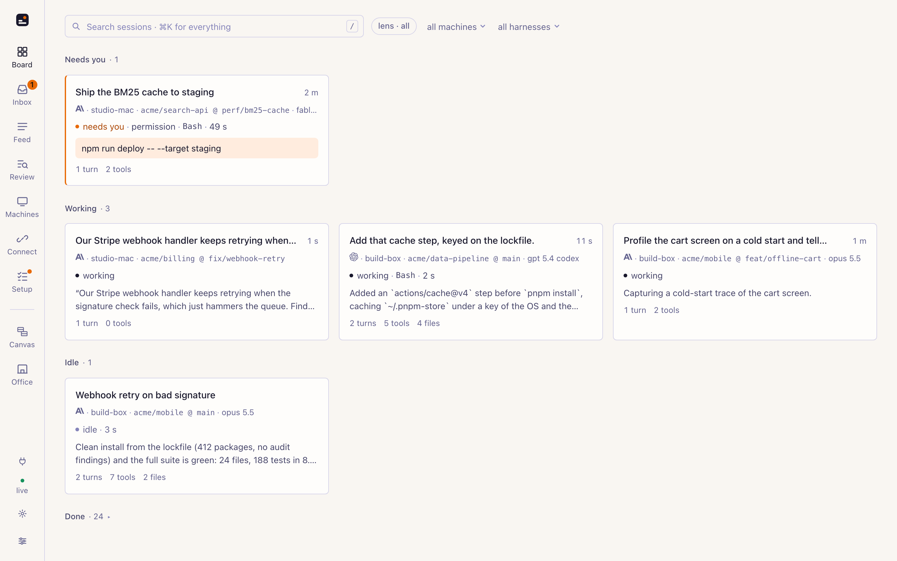

One Node process on your machine is a [sessionpipe receiver](https://github.com/spacesheep-dev/sessionpipe/blob/main/spec/HTTP.md)
with a face. It reads the sessions Claude Code, Codex, Gemini CLI and the other harnesses
run here, takes events from your other machines over the LAN, and shows all of it as a
board, an inbox, a chat per session and a few stranger views. Answer a permission prompt
from the couch; send the next message from the train. Everything stays on the machine
that runs it.

## Install

```sh
npx sessionpipe-gui
```

That starts the receiver on port 7373 and prints where to open it:

```
sessionpipe-gui 0.1.0 · ~/.local/state/sessionpipe-gui

  setup   http://localhost:7373/setup   (first run: your sessions, https, pairing, your phone)
  local   http://localhost:7373
  network http://192.168.1.20:7373/?k=…

  on a phone, scan this (same Wi-Fi):
  █▀▀▀▀▀█ ▀ █▀▀▀▀▀█ …
  from another machine:
    sessionpipe sink add http://192.168.1.20:7373 --tier 3 --token …

  outbox  tailing ~/.local/state/sessionpipe/outbox (14 sessions)
  tls     off (passkeys from a phone need it: --tls)

  Ctrl-C to stop
```

If `sessionpipe install` already ran on this machine there is nothing to configure: the
GUI tails the same outbox files `sessionpipe tail` reads, so your history is there at
once and new events show up in under a second.

### First run

The first time, the board sends a new device to `/setup`: five steps, each green once
this machine has done its part, each with one button. The page checks every two seconds,
so a step turns green by itself when the outbox gets its first event, the certificate is
trusted, the daemon polls, a phone connects, a message comes back `delivered`.

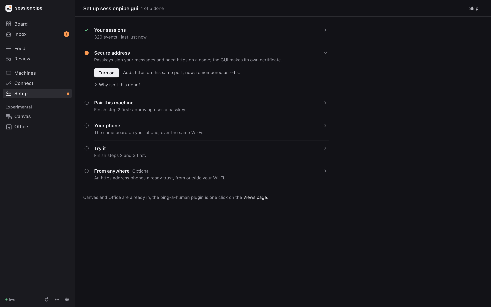

1. **Your sessions**: `npx sessionpipe install` if the CLI is missing.
2. **Secure address**: turn on https from the GUI's own local CA (no restart) and trust it
   on this Mac. Passkeys need it.
3. **Pair this machine**: runs `sessionpipe control pair` for you; approve the six digits
   with your passkey on the page.
4. **Your phone**: the QR code and the steps to trust the CA on iPhone or Android.
5. **Try it**: one message to a live session; green when it comes back `delivered`.

*Skip setup* keeps the board as the front page; the rail keeps a *Setup* entry until the
steps are green. The setup routes answer only from this machine.

### Three ways to get data in

| | |
|---|---|
| **This machine** | Zero config. `~/.local/state/sessionpipe/outbox` is tailed every 500 ms at tier 3. `--no-outbox` turns it off, `--outbox DIR` points elsewhere. |
| **Another machine** | On it, after `npx sessionpipe install`: `sessionpipe sink add http://<this-machine>:7373 --tier 3 --token <sink token>`. The exact line, filled in, is on the Connect page and in the banner. `--tier` is how much that machine sends ([tiers](https://github.com/spacesheep-dev/sessionpipe#privacy-tiers)). |
| **Demo** | `sessionpipe-gui --demo` runs a synthetic team so every state is on the board without running an agent. `--replay file.jsonl` replays any sessionpipe JSONL file. |

## Tour

### Board

Sessions grouped by state, in the order you would look: **needs you**, **working**,
**stale**, **idle**, **done** (collapsed, with a count). A card is the title, where it is
(machine, repo @ branch, model), what it is doing (the tool running now and for how long),
and the last thing the assistant said. Subagents nest under their parent. Flags call out
what is off: a slow tool, three errors in a row, the same tool on the same input three
times, repeated compactions, a gap in the sequence. Filter by machine, harness or text;
`⌘K` finds any session from anywhere.

### Session

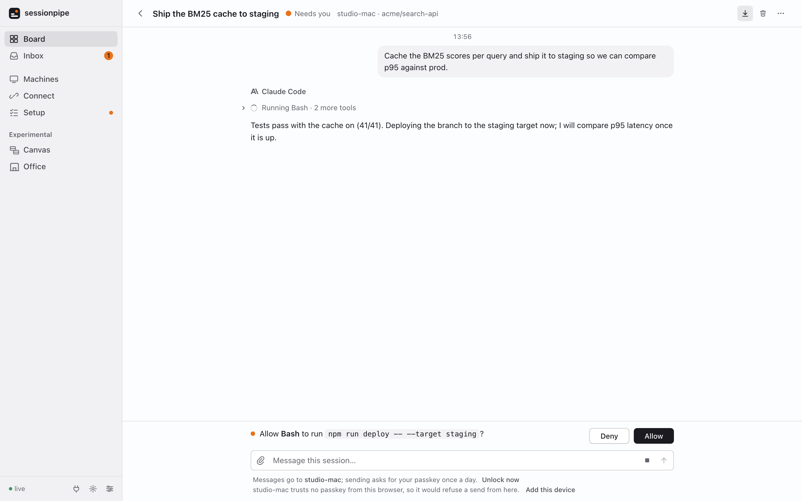

In **Simple** mode (the default) a session is a chat: your prompts on the right, the
assistant's replies as markdown on the left, the tools of each turn folded into one line,
a composer at the bottom. **Advanced** mode is the full timeline: every tool call with
its duration, input and output at tier 3, permission prompts, subagents, compactions,
turn statistics, and a *tier lens* that shows the same session as a tier 0, 1, 2 or 3
receiver would have got it. Both modes open the newest turn first and page older turns
on demand; a session can open as the page or beside it, in a split panel with tabs.

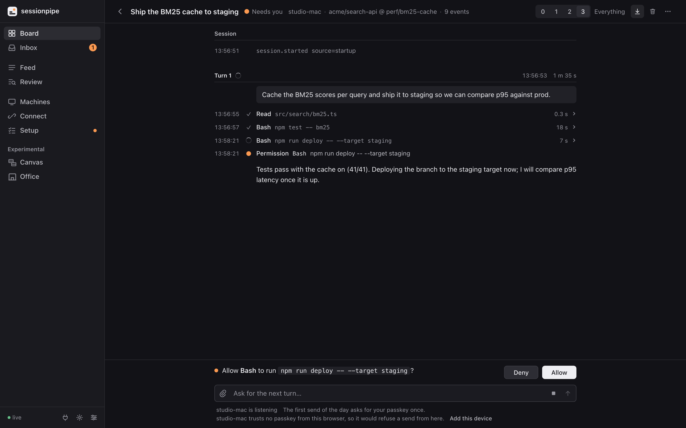

### Inbox and notifications

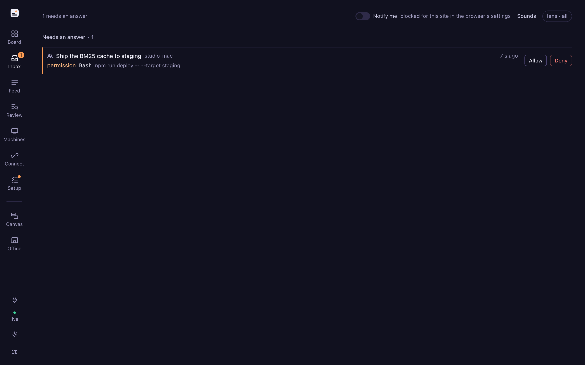

Every open prompt, question and error from every session and machine, newest first, in
two groups: the ones a signed answer can reach (**Allow** / **Deny** right on the row) and
the ones waiting in a terminal. A toast appears for each new one while you are on another
page, with the same two buttons; *Notify me* adds a system notification when the tab is in
the background, and the installed app's badge shows how many are open. Sounds are per
moment (a prompt, a question, an error, a reply delivered), five built in or one you
upload, all per device.

### Canvas

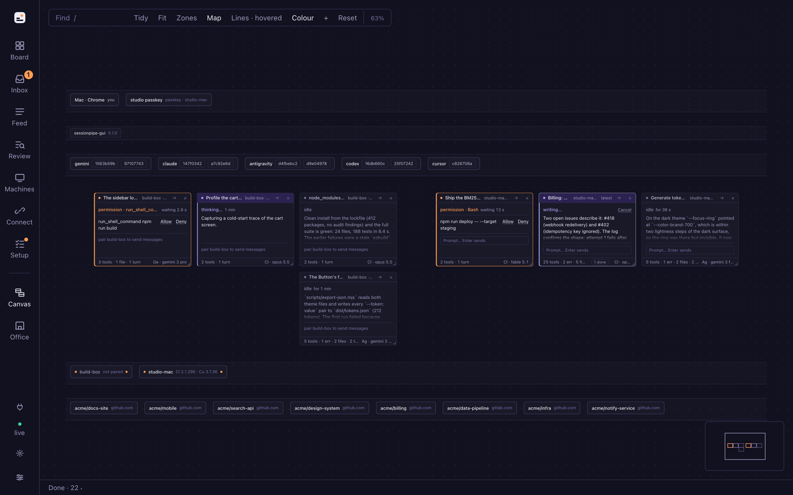

Every live session as a window on an infinite canvas: drag, resize, zoom out to see the
fleet, double-click one to watch it work inline. The **Map** draws the infrastructure
around them in lanes: the browsers looking at this GUI, the accounts per harness, the
machines, the repos, with hairlines for who runs where. Drag an account chip onto a
machine to start a session there. The layout is kept by the receiver, so it is the same
on every device. From the [themes repo](https://github.com/spacesheep-dev/sessionpipe-gui-themes).

### Office

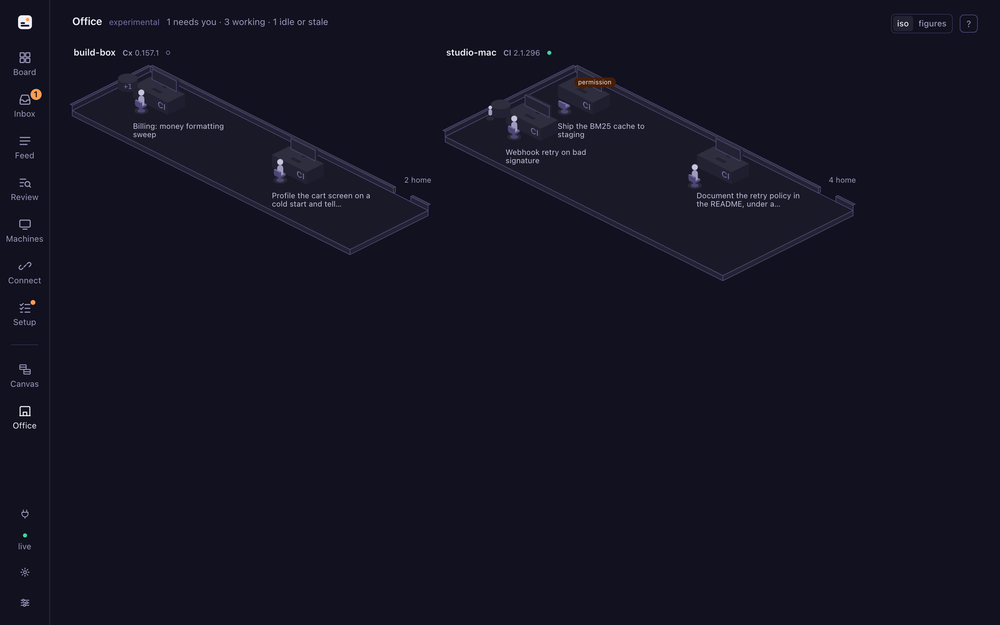

Every machine a room, every live session a person at a desk, every subagent a helper at a
side table. Posture is the state; amber marks who needs you; a tally by the door counts
who went home today. An isometric floor by default, figures on request. Also from the
themes repo.

### Review

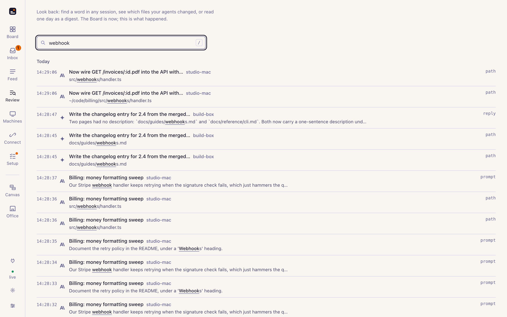

The Board is now; Review is what happened. Search transcripts, tool names, file paths and
titles across every session (a hit opens the session beside the page at that turn). Then
two tabs: the files your agents changed in a range, grouped by repo, and one day as a
digest with totals per machine and per repo. Advanced mode also keeps a **Feed** (every
event as it arrives, like `sessionpipe tail`, paused with `space`) and **Machines** (each
sender, its harness versions, its pairing).

### Connect and your phone

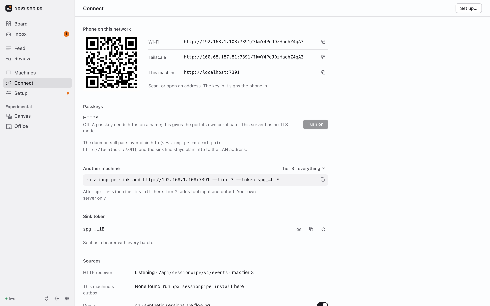

Scan the QR code in the terminal or on the Connect page. The address carries a key that
signs the phone into the page; without it the network answers 401. On the machine itself
(`localhost`) no key is needed. The sink token is separate and only ever travels as a
bearer with event batches.

Passkeys need https on a DNS name, so `sessionpipe-gui --tls` gives the same port a
second protocol: a certificate from the GUI's own local CA for `<machine>.local`,
`localhost` and every LAN address. The QR then opens a plain-http **trust page** that
walks the phone through installing that one certificate (compare the SHA-256 fingerprint
it shows with the one in the profile) and forwards it to `https://<machine>.local:7373`.
The daemon and the sinks keep using plain http.

| 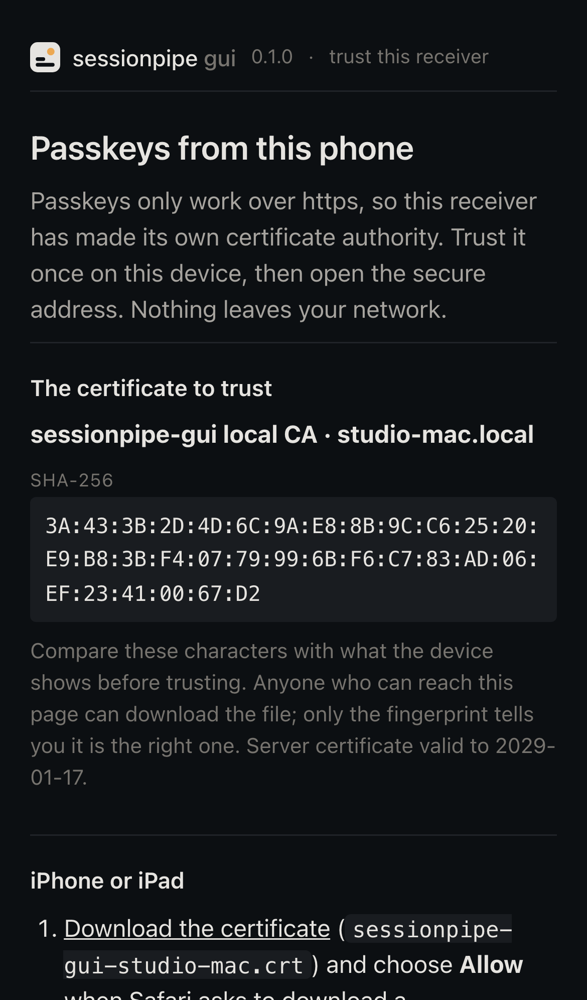 | 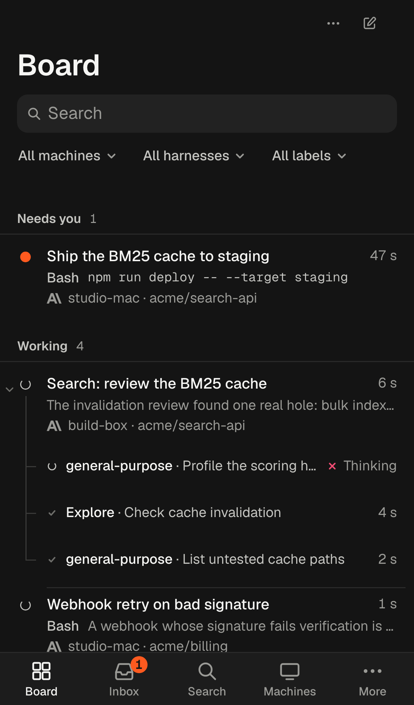 | 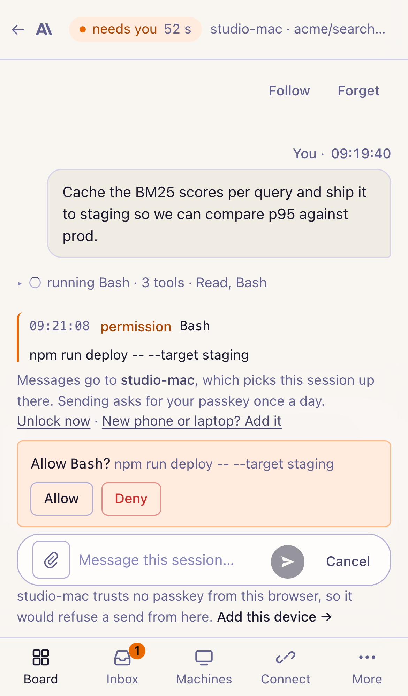 |
|---|---|---|

### Settings and skins

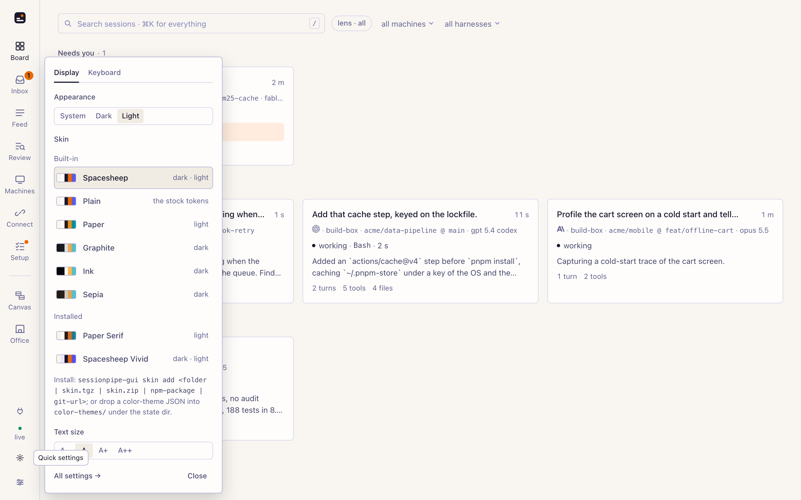

Appearance (system, dark, light), skin and text size are one tap from the rail and are
kept per device. **Spacesheep** is the default skin, the colours of
[spacesheep.dev](https://spacesheep.dev) in both schemes; **Plain** is the stock tokens,
tinted neutrals with amber as the only accent; Paper, Graphite, Ink and Sepia are single
schemes. Settings (`/settings`) holds the rest: Simple or Advanced, the page to open on,
the tier lens, notifications and sounds, the keymap, the installed views, skins and
plugins, what is on disk, and the receiver's own numbers.

### Keyboard

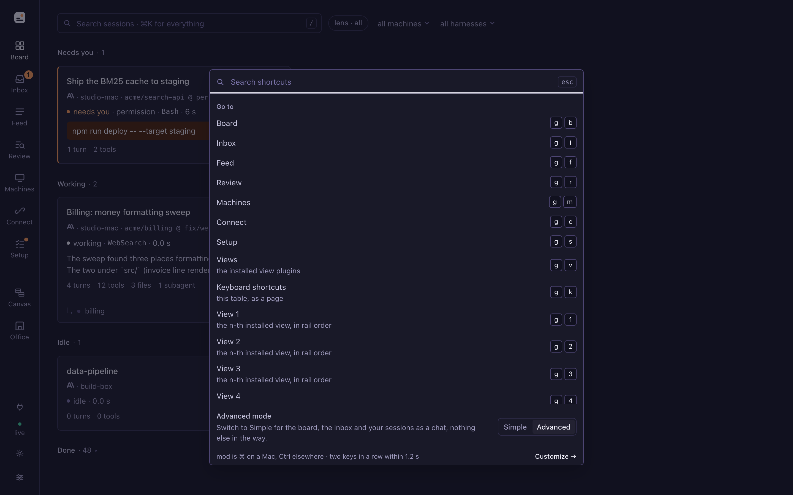

`?` lists every binding in force, `/shortcuts` rebinds them (vim and emacs presets
included). The ones to know: `⌘K` palette, `/` search this page, `j` `k` move,
`Enter` open, `Shift+Enter` open beside, `a` `d` allow or deny the prompt under the
cursor, `p` focus the composer, `l` cycle the tier lens, `t` dark or light, `g` then a
letter to jump between pages, `Esc` back. A view's own keys join the same list.

## Control: talking back

sessionpipe's [control channel](https://github.com/spacesheep-dev/sessionpipe/blob/main/spec/CONTROL.md)
lets a page you have open send a message to a session, answer a permission prompt, stop a
turn or start a new session, each command signed with a passkey and verified on the
machine that runs the agent. This GUI is a full control receiver; `/setup` pairs the
machine you are on, and for any other machine:

```sh
sessionpipe control pair http://<this-machine>:7373
```

The terminal prints a link and six digits; the page shows the same six; you approve with
your passkey. From then on a session has a composer and Allow / Deny on its open prompts,
from the session page, the Inbox, a toast or the palette. The first send of a day asks
for the passkey once. A phone makes its own passkey on `/add-device`; a device the
machine already trusts compares six digits and approves.

**Images.** Paste, drop or attach up to six images (8 MB each) in the composer. The GUI
stores them and the signed text names them, by absolute path when the session runs on
the machine the GUI runs on, by an authenticated URL otherwise, so the agent can open
them.

**From Telegram.** The [ping-a-human plugin](https://github.com/spacesheep-dev/sessionpipe-gui-themes/tree/main/packages/plugin-ping-a-human)
sends a Telegram message when a session needs you, with Allow and Deny buttons. The one
you tap comes back as a *suggestion* beside the prompt, "Allow suggested by Misha on
Telegram · Confirm", and you confirm it with your passkey.

**The security model, in six lines.**

1. Every command is signed on your device by a WebAuthn passkey, or by a day key the passkey vouched for once that day.
2. The receiver carries commands and holds a bearer token per machine. It holds no key that can sign, so it cannot forge one.
3. The machine's daemon verifies the signature against the keys enrolled at its own terminal, then delivers through the harness's documented hooks.
4. A plugin can suggest an answer. Nothing reaches a machine until a person confirms with a passkey; nothing auto-allows.
5. A key is trusted only through pairing at the machine's terminal, or a signed `key.add` from a device the machine already trusts. Keys are removed at the terminal, never here.
6. The sink token authenticates event batches; the UI key signs a browser into the page. Neither authorizes a command.

## Extending

Three kinds of extension, one installer, all kept outside the GUI under its state dir
and installed, linked for development or removed with the same verbs. A **view** is an
ES module that draws the board its own way on a page of the GUI, with a `ThemeApi` for
the live state, control, storage and the keymap. A **skin** is tokens, fonts, radius,
density and an optional stylesheet, no code. A **plugin** is server-side code in the
receiver process that reacts to events: notifications, suggested answers.

```sh
sessionpipe-gui view add   <folder | .tgz | .zip | npm package | git url>
sessionpipe-gui skin add   <folder | .tgz | .zip | npm package | git url>
sessionpipe-gui plugin add <folder | .tgz | .zip | npm package | git url>
```

A view is code running in the board page with everything the page has; a plugin is code
running in the receiver with everything this machine has; a skin runs no code. Install
only what you trust. The authoring guides are [docs/theme-authoring.md](docs/theme-authoring.md),
[docs/skin-authoring.md](docs/skin-authoring.md) and [docs/plugin-authoring.md](docs/plugin-authoring.md);
the official views, skins and plugins live in
[sessionpipe-gui-themes](https://github.com/spacesheep-dev/sessionpipe-gui-themes).

## How it works

```
 ┌──────────── this machine ──────────────┐      ┌── other machines ──┐
 │ sessionpipe hooks → outbox/*.jsonl      │      │ sessionpipe sinks  │
 │        │ (tailed, zero config)          │      │  POST /events      │
 │        ▼                                │      └─────────┬──────────┘
 │  sessionpipe-gui :7373 ◄────────────────┼────────────────┘
 │   store: JSONL per session + index      │
 │   receiver · control · UI API · SSE     │◄──── phones and laptops on the LAN
 │   static web app · views · plugins      │      http://<lan-ip>:7373/?k=<ui key>
 └─────────────────────────────────────────┘      https://<machine>.local:7373 (--tls)
```

The receiver implements the sessionpipe HTTP binding and the control channel
(`GET /.well-known/sessionpipe`, `POST /api/sessionpipe/v1/events`,
`/api/sessionpipe/v1/control`) and accepts every tier up to 3. The browser gets one
snapshot and then deltas over Server-Sent Events. The board's states (`needs_you`,
`working`, `stale`, `idle`, `done`) and flags are the receiver's readings of the
protocol's facts, as the spec intends; they are never sent anywhere.

**Where things live.** Everything under `~/.local/state/sessionpipe-gui/` (or `--state DIR`):

| | |
|---|---|
| `events/<harness>/<session>.jsonl` | One append-only file per session, the full events. An index of summaries and slim events is rebuilt at boot; big strings are read back from disk by byte offset on demand. |
| `config.json` | The sink token, the UI key, whether TLS mode is on. |
| `control/` | Paired machines (token hashes) and their queues. |
| `tls/` | The local CA and the server certificate (`--tls`). |
| `attachments/` | Images sent from the composer. |
| `themes/`, `skins/`, `plugins/` | Installed extensions; `plugins-settings/` and `plugins-storage/` beside them, mode 0600. |

Delete a session from its page (*Forget*, which also honours a `session.forgotten`
event) or delete the directory to start over. `--keep-days N` (default 14) shortens the
in-memory preview of older events; the files are never trimmed.

**Privacy.** The GUI shows what arrived and nothing more. What leaves each machine is
decided there, by the tier its sink is set to, with secrets redacted before the outbox;
the tier lens here lets you see the same session as a lower-tier receiver would have got
it, to decide what a team board should receive. Nothing in the web bundle calls anywhere
but its own origin; the server's only outbound request is the download of an extension
you ask it to install by URL or npm name; a plugin's secrets are masked on the wire and in
its logs.

## Development

```sh
npm install
npm run dev            # server on :7373 (rebuilt on change) + Vite on :5173 proxying to it
npm run build          # dist/ (server) + dist/web (app)
npm start -- --demo    # the built server with synthetic sessions
npm test               # vitest: store, receiver, control, conformance, demo, tls, plugins, ui
npm run test:e2e       # playwright: a built server in demo mode, desktop and phone, on :7311 / :7312
npm run typecheck && npm run lint
```

The conformance runner scores this receiver against the delivery scenarios in a
sessionpipe checkout (`npm run conformance -- http://127.0.0.1:7373 --fixtures
../sessionpipe/conformance/delivery --token <sink token>`; start the server with
`--test-door` for the control scenarios). Opt-in suites: `SPGUI_PERF=1` for browser
memory under load.

```
server/     the receiver: store, http receiver, control, tls, demo, extensions (views, skins, plugins), setup
web/        the app: React 18 + Vite, hand-written CSS with design tokens, no component library
shared/     the contract both sides import: wire types, routes, the ThemeApi, PluginApi and skin manifests
docs/       brand, authoring guides, screenshots
test/       vitest fixtures and the Playwright suite
```

Architecture, module owners and the API contract: [ARCHITECTURE.md](ARCHITECTURE.md).
Contributing: [CONTRIBUTING.md](CONTRIBUTING.md). Every commit is signed off under the
[DCO](DCO) (`git commit -s`); there is no CLA.

## License

Apache-2.0 ([LICENSE](LICENSE), [NOTICE](NOTICE)). This GUI is a receiver that speaks the
sessionpipe protocol; it is not part of the sessionpipe project and is not endorsed by it.
The protocol is by Michael Makarov and contributors; "sessionpipe" and the sessionpipe
logo are [marks of Michael Makarov](https://github.com/spacesheep-dev/sessionpipe/blob/main/TRADEMARKS.md).
The mark in `web/public/brand/` is this project's own ([docs/brand.md](docs/brand.md)).
Claude Code, Codex and Gemini are trademarks of their owners, named here only to identify
the software a session runs in.
