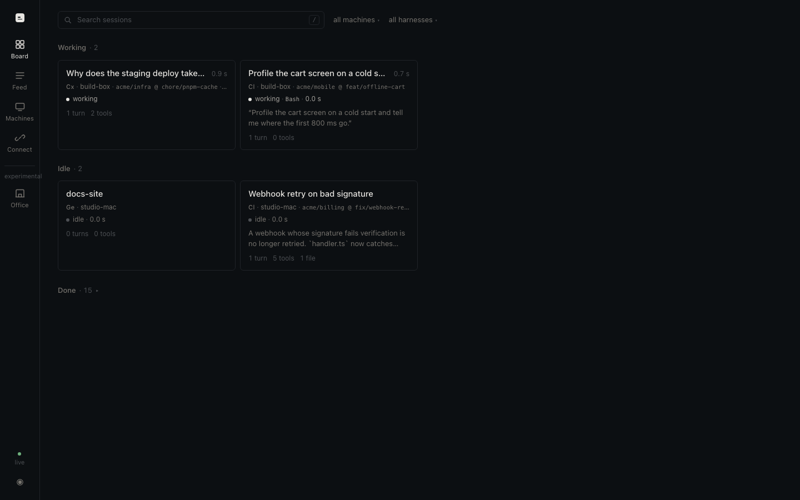

# sessionpipe-gui

**The local GUI for [sessionpipe](https://github.com/spacesheep-dev/sessionpipe).** One
process on your machine shows every coding-agent session you run — Claude Code, Codex,
Gemini CLI, Antigravity and the rest — as it happens: who needs you, who is working, what
each one is doing, and the full transcript when you open one. Nothing leaves your
computer. No server, no database, no account, no telemetry.

```sh
npx sessionpipe-gui
```

That starts the board on [http://localhost:7373](http://localhost:7373), reads this
machine's sessionpipe outbox directly (nothing to configure if `sessionpipe install` ran
here), and prints a QR code so a phone on the same Wi-Fi can open it.



## What you get

| Page | What it shows |
|---|---|
| **Board** | Sessions grouped by state: needs you, working, stale, idle, done. Each card: title, machine, repo @ branch, model, the tool running now, the last thing the assistant said. Subagents nest under their parent. |
| **Session** | The timeline, turn by turn: your prompt, the reply, every tool call with its duration, tool input and output at tier 3, permission prompts, subagents, compactions. A *tier lens* shows what a tier 0/1/2/3 receiver would see. |
| **Feed** | The live event stream, like `sessionpipe tail`, with filters and search. |
| **Machines** | Every machine that reports here, its harness versions, and its control status. |
| **Connect** | The QR code and address for a phone, the one-line command for another machine, the sink token, and what this receiver is doing. |
| **Themes** | Plugins that draw the board their own way, on the rail under *experimental*: the office from the `sessionpipe-gui-themes` repo (each machine a room, each session a person at a desk), and whatever you install with `sessionpipe-gui theme add`. |

Keyboard: `/` search, `j` / `k` move, `Enter` open, `Esc` back. Dark and light follow the
system; `prefers-reduced-motion` is honoured.

## Three ways to get data in

1. **This machine.** `sessionpipe-gui` tails `~/.local/state/sessionpipe/outbox`, the same
   files `sessionpipe tail` reads. Full history appears at once, new events in under a
   second. No sink, no token.
2. **Another machine on your network.** On it, after `npx sessionpipe install`:
   ```sh
   sessionpipe sink add http://<this-machine>:7373 --tier 3 --token <sink token>
   ```
   The exact line, with the address and token filled in, is on the Connect page and in
   the terminal banner. `--tier` is how much that machine sends ([sessionpipe tiers](https://github.com/spacesheep-dev/sessionpipe#privacy-tiers)).
3. **Demo.** `sessionpipe-gui --demo` runs a synthetic team so you can see every state
   without running an agent. `--replay file.jsonl` replays any sessionpipe JSONL file.

## From a phone

Scan the QR code in the terminal or on the Connect page. The address carries a key that
signs the phone in; without it, the page answers 401 on the network. On the machine
itself (`localhost`) no key is needed. The sink token is separate and only ever travels as
a bearer with event batches.

## Control: talk back to a session

sessionpipe's [control channel](https://github.com/spacesheep-dev/sessionpipe/blob/main/spec/CONTROL.md)
lets you send a message to a session, answer a permission prompt, or start a new session,
each command signed with a passkey and verified on the machine that runs the agent. This
GUI is a full control receiver. To pair the machine you are on:

```sh
sessionpipe control pair http://localhost:7373
```

The terminal prints a link and six digits; open the link on `http://localhost:7373`,
compare the digits, approve with your passkey (Touch ID). From then on a session page has
an input and Allow / Deny on open permission prompts. The first send of a day asks for the
passkey once. Passkeys need a secure context, so sending works from the machine's own
browser (`localhost`); on a phone over plain `http` the controls explain why they are off.

## It is a receiver

`sessionpipe-gui` implements the sessionpipe HTTP binding and the control channel on the
receiver side: `GET /.well-known/sessionpipe`, `POST /api/sessionpipe/v1/events` (dedup on
harness, session and seq; `session.forgotten` deletes), and `/api/sessionpipe/v1/control`
(pair, hello, long-poll, ack, off). It passes the delivery scenarios in the sessionpipe
conformance fixtures:

```sh
node dist/conformance.js http://127.0.0.1:7373 --fixtures ../sessionpipe/conformance/delivery --token <sink token>
```

(start the server with `--test-door` for the control scenarios; the door only answers
loopback).

## Where things live

| | |
|---|---|
| Events | `~/.local/state/sessionpipe-gui/events/<harness>/<session>.jsonl`, one file per session, append-only |
| Config | `~/.local/state/sessionpipe-gui/config.json`: the sink token and the UI key |
| Control | `~/.local/state/sessionpipe-gui/control/`: paired machines, queues |

Delete a session from its page (Forget), or delete the whole directory to start over.

## Options

```
--port N          listen on port N (default 7373)
--host H          bind address (default 0.0.0.0: this machine and the LAN)
--state DIR       where events and config live
--no-outbox       do not tail this machine's sessionpipe outbox
--outbox DIR      tail a sessionpipe state dir other than the default one
--demo            generate synthetic sessions
--replay FILE     replay a sessionpipe JSONL file (--speed N: 0 = at once, 1 = real time)
--rp-id HOST      WebAuthn rp id control passkeys are made for (default localhost)
--test-door       loopback-only test door for the conformance runner
--open            open the board in the browser
```

## Development

```sh
npm install
npm run dev            # server on :7373, Vite on :5173 proxying to it
npm run build          # dist/ (server) + dist/web (app)
npm test               # vitest: store, receiver, control, conformance, demo
npm run test:e2e       # playwright against a built server in demo mode
npm run typecheck && npm run lint
```

Architecture, module owners and the API contract between server and app:
[ARCHITECTURE.md](ARCHITECTURE.md). Contributing: [CONTRIBUTING.md](CONTRIBUTING.md)
(DCO sign-off, no CLA).

## License

Apache-2.0 ([LICENSE](LICENSE), [NOTICE](NOTICE)). The sessionpipe protocol is by Michael
Makarov and contributors; "sessionpipe" is a mark of Michael Makarov.
